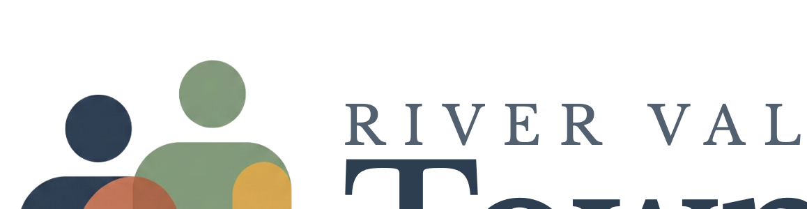

# Town Square — brand / logo

> Live copy of the approved brand, moved out of `local/archive/townsquare-v1/`
> on 2026-08-03. The archive keeps its own copy; this is the one to use.
> Location line currently reads "River Valley", swap it per town with
> `build.py --location`.

The logo is an **icon + wordmark lockup**. **Town Square** is the constant brand;
**River Valley** is a smaller, swappable **location label** (the app is multi-town —
each town gets its own location line, same mark + wordmark).

The mark is two overlapping rounded people plus a terracotta speech bubble with
gold "activity" dots — community + *what's happening*. Everything is hand-built
clean vector (exact brand hex, real Libre Baskerville), so it scales from favicon
to billboard.



## Files

| File | Use |
|---|---|
| `logo-lockup.svg` | **Master lockup**, editable text (Libre Baskerville embedded). Best for web. |
| `logo-lockup-outlined.svg` | Same lockup, text converted to paths — universal (Illustrator/Figma/print). |
| `mark.png` | The approved standalone mark, raster. This is what the app icons were rendered from. |
| `mark.svg` | **The mark as clean vector**, full color, tight-cropped (`viewBox="17 11 87 92"`). Added 2026-08-03 for in-app use — this is what the hi-fi design inlines. Generated from `build.py`'s `icon_group()` geometry. |
| `mark-mono-alert.svg` | Same mark, single-color cream knockout for the emergency screen's alarm red (`#FFEDE7` on `#7E1F0C`). |
| `png/` | Rendered PNG exports: `appicon-1024`, `apple-touch-icon-180`, `favicon-32`, `logo-lockup`. |
| `build.py` | Generator for the two lockup SVGs. Re-run to regenerate or make a new location. |
| `_fonts/` | Libre Baskerville variable font + OFL license. |

**Corrected 2026-08-03.** An earlier version of this table listed `icon.svg`,
`appicon-cream.svg`, `appicon-navy.svg` and `appicon-terracotta.svg`. Those
files do not exist and were never tracked in git. `build.py` only emits the two
lockup SVGs. The app icon PNGs were rendered from `mark.png` via `_render1.sh`.
If you need a vector app icon or the tile variants, they have to be built.

## Colors

| Token | Hex | Role |
|---|---|---|
| Navy | `#2C3E50` | Primary / wordmark / front figure |
| Terracotta | `#C4775A` | Speech bubble / warm accent |
| Sage | `#7D9B76` | Second figure (head) |
| Gold | `#D4A853` | Second figure (shoulders) / activity dots |
| Cream | `#FAF8F5` | Background |
| Surface | `#FFFDFB` | Light tile |

(Matches the app's existing 2b design system.)

## Type

**Libre Baskerville** (SIL OFL, included in `_fonts/`). Wordmark ≈ weight 600;
location eyebrow = weight 400, uppercase, letter-spaced.

## Swapping the location (per town)

The location line is a template field. To make a new town's lockup:

```bash
cd docs/design/brand
python3 build.py --location "Ozark Highlands"
# -> logo-lockup-ozark-highlands.svg (+ -outlined.svg), canvas auto-fits
```

Or, in `logo-lockup.svg`, edit the `<text data-field="location">` line directly.

## Regenerate everything

```bash
cd docs/design/brand
python3 build.py          # rebuilds all SVGs
# PNG exports: see _render1.sh (Chrome, exact sizes) + ImageMagick for the lockup
```

## Note: favicon at tiny sizes

The full mark gets busy below ~32px. For 16px favicons, a simplified single-element
glyph (e.g. just the speech bubble) reads better — not yet built; ask if you want it.

**Updated 2026-08-03.** Tested `mark.svg` at 20 / 22 / 26 / 46px against the app's
cream: the four color masses stay distinct and it reads fine, so the app UI uses the
full mark at those sizes rather than a simplified glyph. The ~32px caveat still
stands for a 16px *favicon*, where the tail and the gold panel do collapse.
