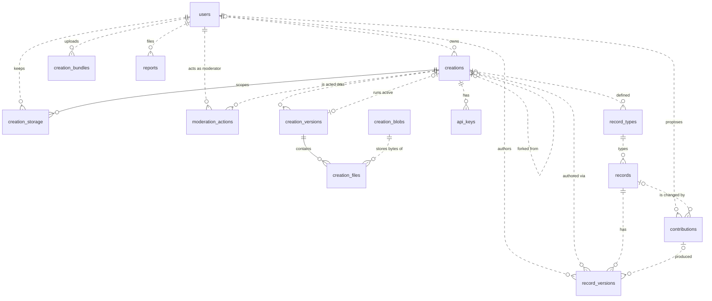
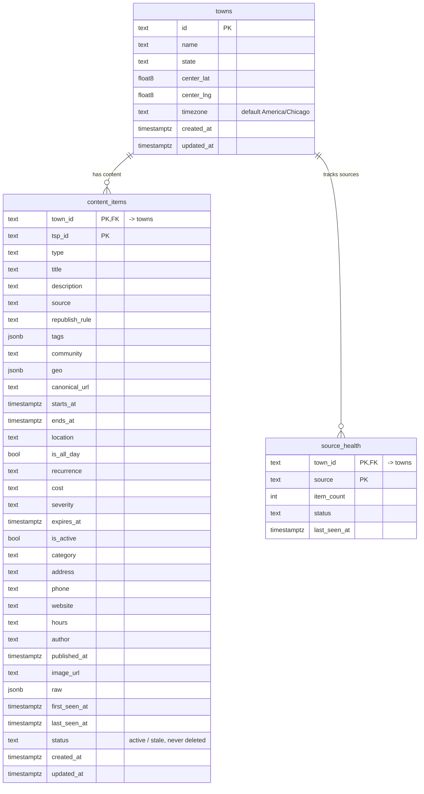
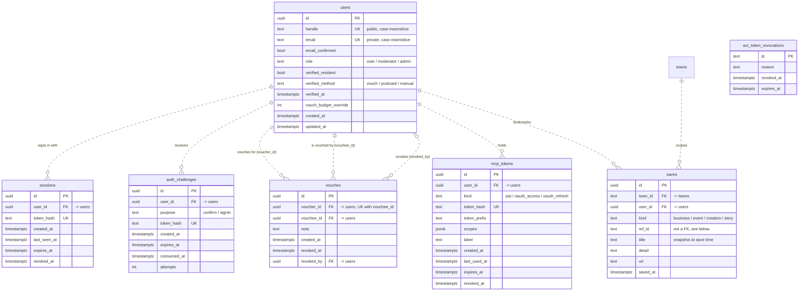
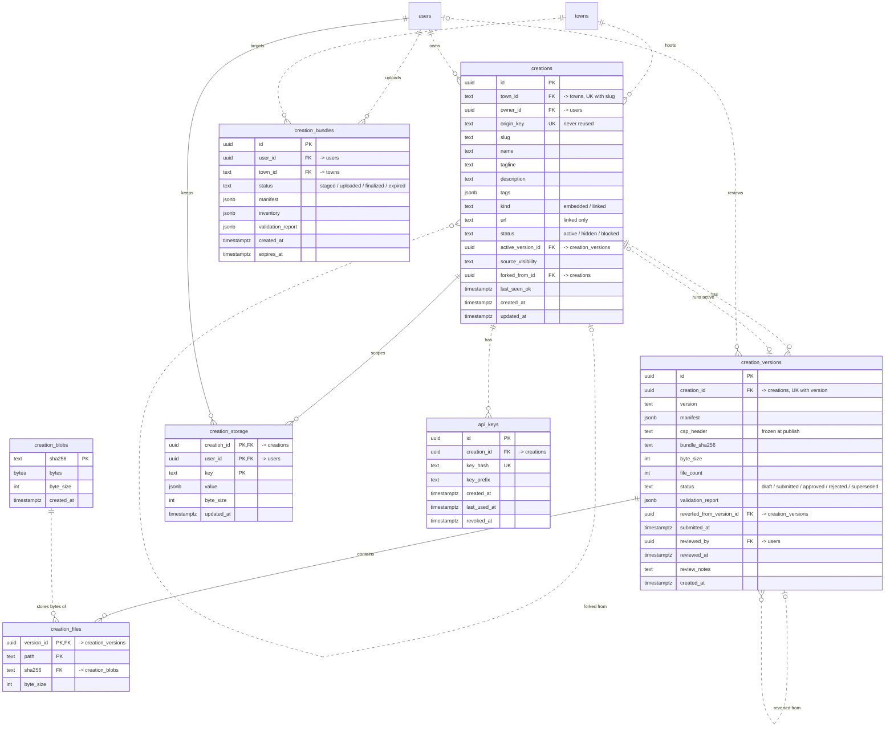
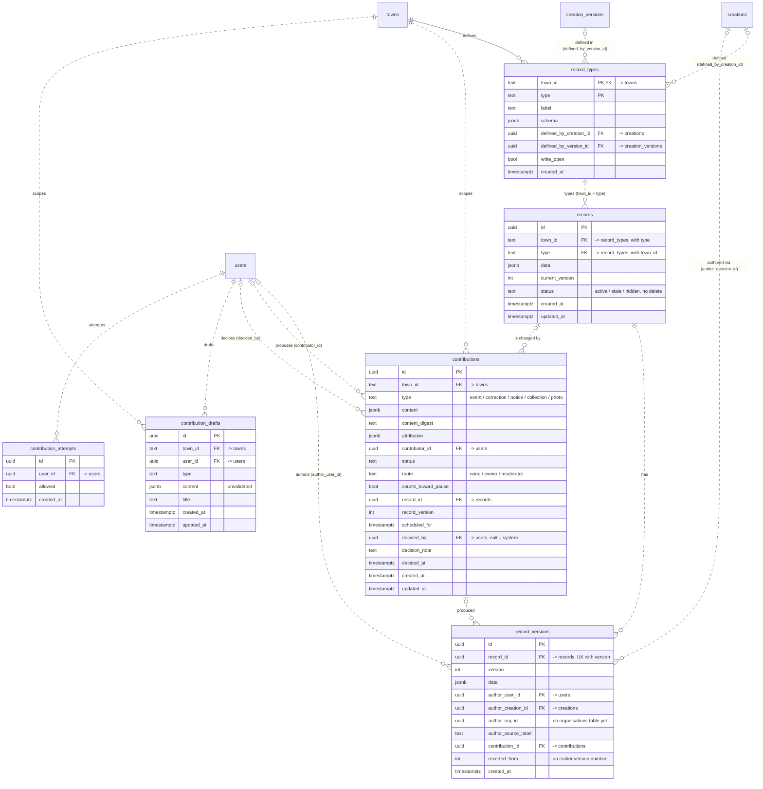
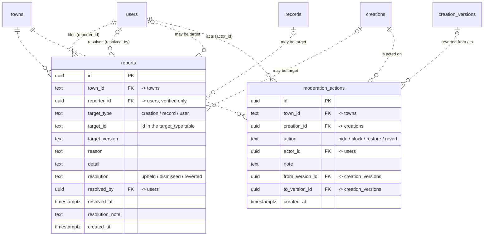

# Database ERD

Entity-relationship diagrams for the Town Square Postgres database, drawn from
[`src/schema.ts`](src/schema.ts) (25 tables, migrations `0000` to `0002`).
GitHub draws the diagrams below automatically. Images for slides and reports
are in [`erd/`](erd/).

## How to read these

- **Crow's foot notation.** `||` exactly one, `o|` zero or one, `}o` zero or
  more, `}|` one or more.
- **Solid line:** the child's primary key includes the parent's key (an
  identifying relationship), e.g. a `content_items` row is keyed by `town_id`.
  **Dashed line:** an ordinary reference.
- **No relationship here is a database foreign key.** The schema declares none.
  Every line is a link the application keeps by naming convention (`user_id`,
  `creation_id`, `town_id`, ...). Some are deliberately loose; see
  [Links that are not lines](#links-that-are-not-lines).
- **PK** primary key, **FK** column that refers to another table, **UK** unique.
  A key made of several columns is marked on each of them.
- A box with no columns belongs to another section and is shown for context.

## Overview

How the areas connect: people, creations, and shared records. To keep this one
picture readable it leaves out two kinds of table, which the section diagrams
below show in full:

- **`towns`**, because almost every table carries a `town_id`.
- **Tables that link only to `users`:** `sessions`, `auth_challenges`,
  `vouches`, `mcp_tokens`, `saves`, `contribution_drafts` and
  `contribution_attempts`. Also `content_items` and `source_health`, which link
  only to `towns`, and `act_token_revocations`, which links to nothing.

`act_token_revocations` stands alone: it lists ids of stateless tokens to cut
off early, and those tokens have no table of their own.

## Town and ingested content

The town itself, and what is scraped into it. Content is never deleted; it is
marked `stale`.

## People and access

Accounts are deliberately thin: no real name, no password column anywhere.
Sign-in is by one-time email challenge.

## Creations

Apps residents build. Every version is reviewed before it can run, files are
stored by content hash, and nothing is hard-deleted.

## Records and contributions

Shared town data that creations read and write (the SDK's `records.*`), and
the proposals residents submit. Every change is a new version; there is no
delete. Drafts are the one thing that is ever really deleted.

## Moderation

Reports are residents asking for a look; moderation actions are the town's
append-only record of what a moderator actually did.

## Links that are not lines

- **`saves.ref_id`** names a business, event, creation or story (`kind` says
  which), but it is deliberately not a foreign key. Town content is re-scraped
  and its ids come and go, and a save is a snapshot (`title`, `detail` and
  `url` as they read when saved), so a bookmark survives its target changing.
- **`reports.target_id`** points into `creations`, `records` or `users`
  depending on `target_type`. That is why the moderation diagram shows three
  "may be target" lines.
- **`record_versions.author_org_id`** is reserved for organisations posting in
  public, and there is no organisations table yet.
- **`record_versions.reverted_from`** and **`contributions.record_version`**
  are version numbers, not ids: together with `record_id` they name a row in
  `record_versions`.
- **`creation_versions.bundle_sha256`** is a hash of the whole bundle, not a
  row in `creation_blobs`. Each file's `sha256` is.

## Keeping this up to date

This file is written by hand from `src/schema.ts`. When a migration adds or
changes a table, update the matching section and re-export the images in
[`erd/`](erd/).
